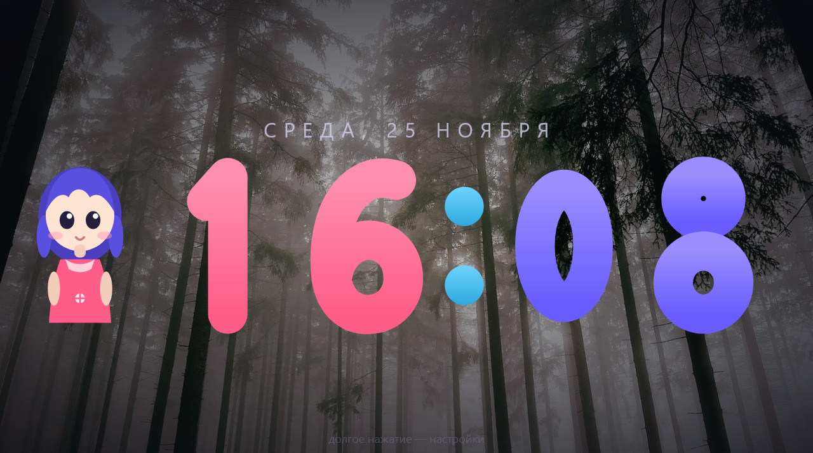

# Chibi Clock

Turn an old Android tablet into a cute wall clock.



A chibi girl, big rounded numerals, a forest behind her, and a screen that never
goes dark. One small APK, no ads, no analytics, **no permissions at all** — the
clock is a local HTML page inside the app.

Made because a 2018 tablet is a terrible tablet and an excellent clock.

## What it does

- Full-screen kiosk clock, portrait or landscape
- Screen stays awake while the app is open (no dimming, no screen-off)
- Night schedule: dims to your chosen brightness between two hours
- Burn-in protection: the picture drifts a few pixels every minute
- 24h / 12h, optional seconds, optional mascot
- Works offline forever, needs nothing but the APK
- `minSdk 21` — installs on Android 5.0 and up, which covers almost any tablet
  from the last decade

## Install

1. Download `chibi-clock-<version>-debug.apk` from [Releases](../../releases).
2. Allow "install unknown apps" for your file manager / browser.
3. Install, open, done.

Long press anywhere on the clock (or the back key) opens settings.

> **Signing:** the APK is signed with a public "community" key that is committed to
> the repo on purpose (`app/keystore.jks`, password `chibiclock`), so a local build
> and a CI build produce the same signature and newer APKs install over older ones.
> Certificate fingerprint (SHA-256):
> `5B:79:57:6B:4E:3A:B1:28:85:BE:EF:E7:FE:7C:78:12:C0:22:CC:73:3E:3A:11:C8:60:B7:05:3B:6D:D5:6E:11`.
> It is not a Google Play upload key — Play would not accept it.

## Build it yourself

Requirements: JDK 17, Android SDK with platform 36, Gradle 8.14+.

```bash
echo "sdk.dir=$HOME/Android/Sdk" > local.properties
./gradlew assembleDebug
# app/build/outputs/apk/debug/app-debug.apk
```

The web clock lives in `clock/` and is shared: the Android app uses it as its
assets directory, and you can open `clock/index.html` in any browser to preview.

## Project layout

```
clock/                the clock itself — HTML/CSS/JS + SVG digits
  digits/             generated numeral pack (see art/gen_digits.py)
  themes/             backgrounds
app/                  Android wrapper (WebView kiosk, brightness, shifts)
art/                  generators for digits and the launcher icon
linux/                systemd units for the postmarketOS / Linux kiosk version
```

## Make your own digits

Drop files named `<digit>_h.svg` (hours), `<digit>_m.svg` (minutes) and
`colon.svg` into `clock/digits/` and rerun the build. Delete them and run
`python art/gen_digits.py` to regenerate the bundled pack.

The clock renders whatever you put there, so a custom pack is a folder copy away.

## Credits and licensing

- Code, SVG numerals, mascot and icon: **MIT** (see `LICENSE`).
- `themes/forest.jpg`: photo from [Pexels](https://www.pexels.com/), used under
  the Pexels license.
- The project started life as a private kiosk for a Xiaomi Mi Pad 4 running
  postmarketOS, inspired by the iOS tweak **AniTime**. AniTime's artwork is
  **not** included here and is not redistributed — it belongs to its author.
  If you own a licensed copy and want that look on your own tablet, point a
  custom pack at your own files.

## Русский

Часы для старых планшетов: чиби-девочка, крупные скруглённые цифры, лес на фоне.
Экран не гаснет, ночью яркость падает по расписанию, раз в минуту картинка
сдвигается на несколько пикселей, чтобы не выгорал экран.

Ставится на Android 5.0 и новее. Разрешений не просит вообще — всё локально.

Долгое нажатие (или кнопка «назад») — настройки. Сборка: `./gradlew assembleDebug`.

Исходники цифр и маскота — SVG, лицензия MIT, можно менять и перекрашивать.
